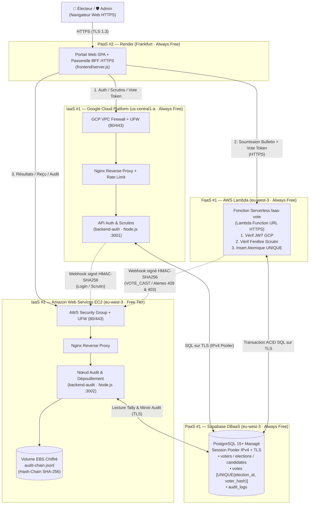

# Architecture Multicloud — Plateforme de Vote Électronique « VoteCloud »

> **Respect strict des contraintes :**
> - **2 IaaS** : Google Cloud Compute Engine (`e2-micro`) + Amazon EC2 (`t3.micro`)
> - **2 PaaS** : Supabase PostgreSQL Managé (DBaaS) + Render Web Service (PaaS Applicatif)
> - **1 FaaS** : AWS Lambda (Node.js 20.x + Function URL HTTPS)
> - **Multicloud** : 4 plateformes distinctes (**GCP**, **AWS**, **Supabase**, **Render**) dont 2 hyperscalers majeurs (**GCP + AWS**)
> - **0 service Azure** (interdiction respectée à 100 %)
> - **Coût cible : 0,00 €** (Always Free & Free Tier étudiant avec alertes de facturation)

---

## 1. Justification des choix Multicloud & Répartition 2 IaaS / 2 PaaS / 1 FaaS

Dans un système de vote électronique de niveau sécurité / cyberdéfense, héberger toute l'infrastructure chez un seul fournisseur crée un **point unique de compromission (Single Point of Trust)**. Notre architecture applique la **séparation cryptographique des pouvoirs (Separation of Duties)** entre fournisseurs cloud :

| # | Modèle | Service Cloud | Fournisseur | Rôle précis | Justification du modèle de service |
|---|---|---|---|---|---|
| **1** | **IaaS #1** | **Compute Engine (`e2-micro`, Ubuntu 22.04)** | **Google Cloud (GCP)** | **Autorité d'Identité & Scrutins (`backend-auth`)** : authentification électeurs (`scrypt` + JWT), administration des scrutins, calcul du nullifier anonymisé (`HMAC-SHA256`) et émission de jetons de vote à courte durée de vie (5 min). | **IaaS justifié** : contrôle total sur le durcissement OS Linux, le pare-feu `UFW` + VPC Firewall, le reverse proxy `Nginx` avec rate-limiting anti-brute-force et la gestion isolée des clés privées d'authentification. |
| **2** | **IaaS #2** | **Amazon EC2 (`t3.micro`, Ubuntu 24.04)** | **Amazon Web Services (AWS)** | **Nœud Indépendant d'Audit & Dépouillement (`backend-audit`)** : reçoit des webhooks signés HMAC, maintient un registre immuable chaîné SHA-256 (`audit-chain.jsonl`) sur son propre volume EBS chiffré, calcule le dépouillement temps réel et réalise la **réconciliation inter-cloud**. | **IaaS justifié** : indépendance totale du stockage local (volume EBS append-only dédié) et isolation réseau (AWS Security Group + UFW) vis-à-vis de l'autorité d'authentification hébergée sur GCP. |
| **3** | **PaaS #1** | **Supabase (PostgreSQL 15+ Managé)** | **Supabase (DBaaS)** | **Base de Données ACID & Urne Électronique** : stocke les électeurs, scrutins, candidats, bulletins anonymisés (`votes`) avec contrainte `UNIQUE(election_id, voter_hash)` et le miroir `audit_logs`. | **PaaS justifié** : aucune gestion d'OS, de patching PostgreSQL ni de sauvegardes ; garantit la cohérence transactionnelle ACID et l'unicité atomique des votes en cas d'accès concurrents. |
| **4** | **PaaS #2** | **Render Web Service (Node.js Managé)** | **Render** | **Portail Web Citoyen & Passerelle BFF HTTPS (`frontend`)** : sert l'interface de vote/résultats/audit, gère la terminaison TLS/HTTPS automatique et proxyfie les appels vers GCP IaaS, AWS Lambda et AWS EC2 (supprime tout problème de Mixed Content/CORS). | **PaaS justifié** : déploiement Git continu (CI/CD), certificat TLS Let's Encrypt automatique et zéro administration serveur pour la couche présentation. |
| **5** | **FaaS #1** | **AWS Lambda (Node.js 20.x + Function URL)** | **Amazon Web Services (AWS)** | **Processeur Serverless de Vote (`faas-vote`)** : vérifie le JWT émis par GCP, contrôle la fenêtre temporelle officielle du scrutin, insère atomiquement le bulletin dans Supabase PaaS, génère le reçu SHA-256 et notifie AWS EC2. | **FaaS justifié** : un scrutin génère des pics soudains de charge (ouverture/clôture) suivis de périodes creuses ; le FaaS passe automatiquement à l'échelle par événement et reste à 0 € au repos (1M req/mois Always Free). |

---

## 2. Schéma d'Architecture (Mermaid)

### 2.1 Topologie Multicloud & Flux Réseau



### 2.2 Séquence Cryptographique d'un Vote & Anti-Double Vote

```mermaid
sequenceDiagram
    actor Voter as 👤 Électeur
    participant Render as PaaS #2 : Render UI
    participant GCP as IaaS #1 : GCP Auth
    participant Lambda as FaaS #1 : AWS Lambda
    participant Supa as PaaS #1 : Supabase PG
    participant EC2 as IaaS #2 : AWS EC2 Audit

    Voter->>Render: 1. Connexion (email + mot de passe)
    Render->>GCP: POST /api/auth/login
    GCP->>Supa: SELECT voter (vérification scrypt)
    GCP-->>Render: JWT de session (2h)

    Voter->>Render: 2. Clique "Voter" sur le scrutin X
    Render->>GCP: POST /api/auth/vote-token (JWT session)
    Note over GCP: Calcule voter_hash = HMAC-SHA256(secret, electionId:voterId)<br/>Signe voteToken (TTL 5 min, sans identité civile)
    GCP-->>Render: voteToken anonymisé

    Render->>Lambda: 3. POST / (Bearer voteToken + electionId + candidateId)
    Note over Lambda: Vérifie signature JWT (issuer=GCP, aud=AWS Lambda)
    Lambda->>Supa: BEGIN; SELECT status, starts_at, ends_at FROM elections
    alt Scrutin clôturé ou à venir (Hors période)
        Lambda->>EC2: Webhook HMAC : OUT_OF_WINDOW_ATTEMPT
        Lambda-->>Render: HTTP 403 (ELECTION_CLOSED / NOT_STARTED)
    else Scrutin OUVERT
        Lambda->>Supa: INSERT INTO votes (election_id, candidate_id, voter_hash, receipt...)
        alt Contrainte UNIQUE(election_id, voter_hash) violée (Double vote)
            Supa-->>Lambda: Erreur PostgreSQL 23505
            Lambda->>EC2: Webhook HMAC : DOUBLE_VOTE_ATTEMPT
            Lambda-->>Render: HTTP 409 (DOUBLE_VOTE_DETECTED)
        else Premier vote valide
            Supa-->>Lambda: COMMIT OK
            Lambda->>EC2: Webhook HMAC : VOTE_CAST (receiptCode, sans candidateId)
            EC2->>EC2: Scelle bloc SHA-256 sur EBS + miroir Supabase
            EC2-->>Lambda: blockIndex + blockHash
            Lambda-->>Render: HTTP 201 + Reçu Cryptographique (VC-XXXX-XXXX)
        end
    end
```

---

## 3. Schéma d'Architecture (ASCII)

```text
                       +--------------------------------------+
                       |      UTILISATEUR (Navigateur Web)    |
                       +------------------+-------------------+
                                          | HTTPS (TLS)
                                          v
                       +--------------------------------------+
                       |  [PaaS #2] RENDER WEB SERVICE        |
                       |  Portail SPA + Passerelle BFF HTTPS  |
                       |  (0 EUR Always Free · sans OS)       |
                       +----+-------------+--------------+----+
                            |             |              |
       (1) Auth / Scrutins  |             | (2) Bulletin | (3) Résultats / Audit
       & Vote Token         |             | + Vote Token | & Vérif Reçu
                            v             v              v
+-------------------------------+  +--------------+  +---------------------------------+
| [IaaS #1] GCP COMPUTE ENGINE  |  | [FaaS #1]    |  | [IaaS #2] AWS EC2 (t3.micro)    |
| VM Ubuntu e2-micro            |  | AWS LAMBDA   |  | VM Ubuntu 24.04                 |
| VPC FW + UFW + Nginx (:80)    |  | Node.js 20   |  | Security Group + UFW + Nginx    |
| backend-auth (:3001)          |  | Function URL |  | backend-audit (:3002)           |
| • scrypt + JWT                |  | • Vérif JWT  |  | • Hash-Chain SHA-256 (EBS)      |
| • voter_hash = HMAC-SHA256    |  | • Fenêtre    |  | • Réconciliation Inter-Cloud    |
+---------------+---------------+  | • Anti-2x    |  +----------------+----------------+
                |                  +--+--------+--+                   ^
                |                     |        |                      |
                |   Webhook HMAC      |        +----------------------+
                +---------------------+------->  Webhooks signés HMAC-SHA256
                |                     |          (VOTE_CAST, 409, 403, LOGIN)
                v                     v                               ^
          +-----+---------------------+-------------------------------+-----+
          |  [PaaS #1] SUPABASE POSTGRESQL 15+ MANAGÉ (Session Pooler IPv4) |
          |  • voters   • elections   • candidates   • audit_logs           |
          |  • votes [CONSTRAINT UNIQUE(election_id, voter_hash)]           |
          |  (0 EUR Always Free · TLS · ACID · 0 gestion d'OS)              |
          +-----------------------------------------------------------------+
```

---

## 4. Mécanismes de Sécurité & Anti-Double Vote

1. **Garantie mathématique de vote unique (Anti-Double Vote) :**
   - Lorsqu'un électeur demande à voter pour un scrutin `E`, **GCP IaaS #1** calcule `voter_hash = HMAC-SHA256(VOTE_HMAC_SECRET, "E:voter_id")`.
   - Ce condensat est **déterministe** (identique si l'électeur re-tente de voter sur `E`), mais **pseudonymisé** (impossible de remonter à l'identité civile depuis la table `votes`).
   - Dans **Supabase PostgreSQL (PaaS #1)**, la contrainte SQL `CONSTRAINT uq_one_vote_per_voter_per_election UNIQUE (election_id, voter_hash)` interdit physiquement l'insertion d'un second bulletin, même en cas d'attaque par requêtes simultanées (*race condition*).
   - Toute violation (`code PostgreSQL 23505`) est interceptée par **AWS Lambda (FaaS #1)**, retourne `HTTP 409 Conflict` et déclenche immédiatement un bloc d'alerte `DOUBLE_VOTE_ATTEMPT` sur **AWS EC2 (IaaS #2)**.
2. **Contrôle serveur de la fenêtre temporelle :**
   - **AWS Lambda** vérifie côté serveur dans la transaction SQL que `status = 'OPEN'` ET `starts_at <= NOW() <= ends_at`. Toute tentative sur un scrutin `CLOSED` ou `UPCOMING` est bloquée (`HTTP 403`) et journalisée (`OUT_OF_WINDOW_ATTEMPT`).
3. **Secret du vote & Vérifiabilité :**
   - La table `votes` ne stocke aucune donnée nominative (`email`, `CIN`, `nom`).
   - Le webhook `VOTE_CAST` envoyé à **AWS EC2** contient `receiptCode` et `receiptHash`, mais **jamais `candidateId`** : le journal d'audit prouve qu'un bulletin valide a été compté sans révéler pour qui l'électeur a voté.
4. **Détection de falsification (Hash-Chain SHA-256 + Réconciliation Inter-Cloud) :**
   - Chaque bloc d'audit sur le disque EBS d'**AWS EC2** inclut le hash SHA-256 du bloc précédent (`block_hash = SHA256(... | prev_hash)`).
   - L'endpoint `/api/audit/tally/:id` compare le nombre de bulletins dans **Supabase (PaaS #1)** au nombre d'événements `VOTE_CAST` scellés sur **AWS EC2 (IaaS #2)**.

---

## 5. Matrice des Coûts, Limites Free Tier & Garde-fous Anti-Facturation (0 €)

| Service Cloud | Fournisseur | Offre Gratuite | Limites gratuites | Pièges à éviter pour rester à **0,00 €** |
|---|---|---|---|---|
| **Compute Engine `e2-micro`** (IaaS #1) | GCP | **Always Free** (+ 300 $ crédits 90 j) | 1 VM `e2-micro`/mois (744 h) + **30 Go disque `pd-standard`** + 1 Go trafic sortant/mois | **Obligatoire :** choisir la région **`us-central1`**, `us-west1` ou `us-east1`, le type **`e2-micro`** et le disque **`Standard Persistent Disk (pd-standard)`** (NE PAS prendre `pd-balanced` ni IP statique non attachée !). |
| **Amazon EC2 `t3.micro`** (IaaS #2) | AWS | **Free Tier / Free Plan** | 750 h/mois (1 instance en continu) + 30 Go EBS (`gp3`/`gp2`) | Ne lancer qu'**une seule** instance `t3.micro` (ou `t2.micro` selon région), volume `16 Go gp3`, **ne pas** créer de NAT Gateway ni d'Elastic IP non associée. Choisir le **AWS Free Plan** (plafond 0 $ automatique) lors de l'inscription. |
| **AWS Lambda** (FaaS #1) | AWS | **Always Free (à vie)** | **1 000 000 requêtes/mois** + 400 000 Go-secondes/mois | Utiliser une **Lambda Function URL** (100 % gratuite) plutôt qu'API Gateway REST (gratuit seulement 12 mois). Mémoire réglée à 256 Mo, timeout 15 s. |
| **Supabase PostgreSQL** (PaaS #1) | Supabase | **Always Free (à vie)** | 2 projets actifs, 500 Mo de stockage, 5 Go bande passante | **Aucune carte bancaire demandée.** Utiliser la chaîne de connexion **Session Pooler (IPv4)** pour compatibilité GCP/AWS. |
| **Render Web Service** (PaaS #2) | Render | **Always Free (à vie)** | 750 h/mois, 512 Mo RAM, HTTPS automatique | **Aucune carte bancaire demandée.** L'instance gratuite se met en veille après 15 min d'inactivité (réveil en ~30 s : penser à ouvrir l'URL 2 min avant de passer en soutenance !). |

### Bonnes pratiques obligatoires anti-facturation
1. **AWS Budgets :** créer un budget *Zero Spend Budget* (alerte email dès **0,01 $**).
2. **GCP Billing Budget :** créer une alerte budgétaire à **1,00 €** avec seuils 50 % / 90 % / 100 %.
3. **Destruction post-soutenance :** juste après la soutenance du **mercredi 25 novembre**, arrêter/supprimer la VM GCP et l'instance EC2 AWS (ou exécuter `terraform destroy`).
