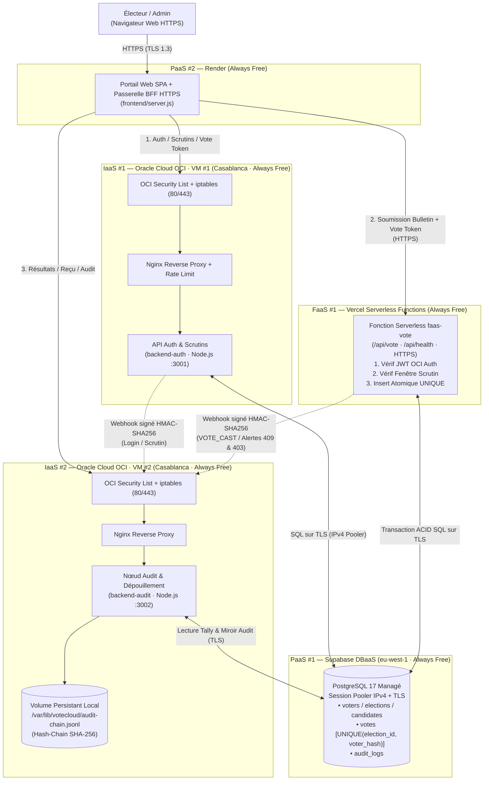

# Architecture Multicloud — Plateforme de Vote Électronique « VoteCloud »

> **Respect strict des contraintes :**
> - **2 IaaS** : Oracle Cloud Infrastructure (OCI) — 2 VMs Ubuntu indépendantes (`votecloud-oci-auth-iaas` + `votecloud-oci-audit-iaas`, Casablanca)
> - **2 PaaS** : Supabase PostgreSQL 17 Managé (DBaaS) + Render Web Service (PaaS Applicatif)
> - **1 FaaS** : Vercel Serverless Functions (Node.js 20 HTTPS)
> - **Multicloud** : **4 fournisseurs distincts** (**Oracle Cloud OCI**, **Supabase**, **Render**, **Vercel**)
> - **0 service Azure** (interdiction respectée à 100 %)
> - **Coût réel : 0,00 €** (Always Free & Free Tier)

---

## 1. Justification des choix Multicloud & Répartition 2 IaaS / 2 PaaS / 1 FaaS

Dans un système de vote électronique de niveau sécurité / cyberdéfense, héberger toute l'infrastructure sur un seul serveur crée un **point unique de compromission (Single Point of Trust)**. Notre architecture applique la **séparation cryptographique des pouvoirs (Separation of Duties)** entre services et fournisseurs cloud :

| # | Modèle | Service Cloud | Fournisseur | Rôle précis | Justification du modèle de service |
|---|---|---|---|---|---|
| **1** | **IaaS #1** | **OCI Compute (`VM.Standard.A1.Flex`, Ubuntu 22.04, `af-casablanca-1`)** | **Oracle Cloud (OCI)** | **Autorité d'Identité & Scrutins (`backend-auth`)** : authentification électeurs (`scrypt` + JWT), administration des scrutins, calcul du nullifier anonymisé (`HMAC-SHA256`) et émission de jetons de vote à courte durée de vie (5 min). | **IaaS justifié** : contrôle total sur le durcissement OS Linux Ubuntu, le pare-feu `iptables` + OCI Security List, le reverse proxy `Nginx` avec rate-limiting anti-brute-force et la gestion isolée de `VOTE_HMAC_SECRET`. |
| **2** | **IaaS #2** | **OCI Compute (`VM.Standard.A1.Flex`, Ubuntu 22.04, `af-casablanca-1`)** | **Oracle Cloud (OCI)** | **Nœud Indépendant d'Audit & Dépouillement (`backend-audit`)** : reçoit des webhooks signés HMAC, maintient un registre immuable chaîné SHA-256 (`audit-chain.jsonl`) sur son propre disque persistant (`/var/lib/votecloud`), calcule le dépouillement temps réel et réalise la **réconciliation inter-cloud**. | **IaaS justifié** : indépendance totale du stockage local (volume persistant append-only dédié) et isolation système vis-à-vis de la VM d'authentification et de la base managée. |
| **3** | **PaaS #1** | **Supabase (PostgreSQL 17 Managé)** | **Supabase (DBaaS)** | **Base de Données ACID & Urne Électronique** : stocke les électeurs, scrutins, candidats, bulletins anonymisés (`votes`) avec contrainte `UNIQUE(election_id, voter_hash)` et le miroir `audit_logs`. | **PaaS justifié** : aucune gestion d'OS, de patching PostgreSQL ni de sauvegardes ; garantit la cohérence transactionnelle ACID, le chiffrement TLS, RLS et l'unicité atomique des votes en cas d'accès concurrents. |
| **4** | **PaaS #2** | **Render Web Service (Node.js Managé)** | **Render** | **Portail Web Citoyen & Passerelle BFF HTTPS (`frontend`)** : sert l'interface de vote/résultats/audit, gère la terminaison TLS/HTTPS automatique et proxyfie les appels vers OCI Auth, Vercel FaaS et OCI Audit (supprime tout problème de Mixed Content/CORS). | **PaaS justifié** : déploiement Git automatisé, certificat TLS Let's Encrypt géré automatiquement et zéro administration système pour la couche présentation. |
| **5** | **FaaS #1** | **Vercel Serverless Functions (Node.js 20 HTTPS)** | **Vercel** | **Processeur Serverless de Vote (`faas-vote`)** : vérifie le JWT émis par OCI Auth, contrôle la fenêtre temporelle officielle du scrutin, insère atomiquement le bulletin dans Supabase PaaS, génère le reçu SHA-256 et notifie OCI Audit. | **FaaS justifié** : un scrutin génère des pics soudains de charge (ouverture/clôture) suivis de périodes creuses ; le FaaS passe automatiquement à l'échelle par événement et reste à 0 € au repos. |

---

## 2. Schéma d'Architecture (Mermaid)

### 2.1 Topologie Multicloud & Flux Réseau



### 2.2 Séquence Cryptographique d'un Vote & Anti-Double Vote

```mermaid
sequenceDiagram
    actor Voter as Électeur
    participant Render as PaaS #2 : Render UI
    participant OCI1 as IaaS #1 : OCI Auth
    participant Vercel as FaaS #1 : Vercel Serverless
    participant Supa as PaaS #1 : Supabase PG
    participant OCI2 as IaaS #2 : OCI Audit

    Voter->>Render: 1. Connexion (email + mot de passe)
    Render->>OCI1: POST /api/auth/login
    OCI1->>Supa: SELECT voter (vérification scrypt)
    OCI1-->>Render: JWT de session (2h)

    Voter->>Render: 2. Clique "Voter" sur le scrutin X
    Render->>OCI1: POST /api/auth/vote-token (JWT session)
    Note over OCI1: Calcule voter_hash = HMAC-SHA256(secret, electionId:voterId)<br/>Signe voteToken (TTL 5 min, sans identité civile)
    OCI1-->>Render: voteToken anonymisé

    Render->>Vercel: 3. POST /api/vote (Bearer voteToken + electionId + candidateId)
    Note over Vercel: Vérifie signature JWT signée par OCI Auth
    Vercel->>Supa: BEGIN; SELECT status, starts_at, ends_at FROM elections
    alt Scrutin clôturé ou à venir (Hors période)
        Vercel->>OCI2: Webhook HMAC : OUT_OF_WINDOW_ATTEMPT
        Vercel-->>Render: HTTP 403 (ELECTION_CLOSED / NOT_STARTED)
    else Scrutin OUVERT
        Vercel->>Supa: INSERT INTO votes (election_id, candidate_id, voter_hash, receipt...)
        alt Contrainte UNIQUE(election_id, voter_hash) violée (Double vote)
            Supa-->>Vercel: Erreur PostgreSQL 23505
            Vercel->>OCI2: Webhook HMAC : DOUBLE_VOTE_ATTEMPT
            Vercel-->>Render: HTTP 409 (DOUBLE_VOTE_DETECTED)
        else Premier vote valide
            Supa-->>Vercel: COMMIT OK
            Vercel->>OCI2: Webhook HMAC : VOTE_CAST (receiptCode, sans candidateId)
            OCI2->>OCI2: Scelle bloc SHA-256 sur disque local + miroir Supabase
            OCI2-->>Vercel: blockIndex + blockHash
            Vercel-->>Render: HTTP 201 + Reçu Cryptographique (VC-XXXX-XXXX)
        end
    end
```

---

## 3. Schéma d'Architecture (ASCII)

```text
                       +--------------------------------------+
                       |      UTILISATEUR (Navigateur Web)    |
                       +------------------+-------------------+
                                          | HTTPS (TLS)
                                          v
                       +--------------------------------------+
                       |  [PaaS #2] RENDER WEB SERVICE        |
                       |  Portail SPA + Passerelle BFF HTTPS  |
                       |  (0 EUR Always Free · sans OS)       |
                       +----+-------------+--------------+----+
                            |             |              |
       (1) Auth / Scrutins  |             | (2) Bulletin | (3) Résultats / Audit
       & Vote Token         |             | + Vote Token | & Vérif Reçu
                            v             v              v
+-------------------------------+  +--------------+  +---------------------------------+
| [IaaS #1] ORACLE CLOUD (OCI)  |  | [FaaS #1]    |  | [IaaS #2] ORACLE CLOUD (OCI)    |
| VM #1 Ubuntu 22.04 Casablanca |  | VERCEL       |  | VM #2 Ubuntu 22.04 Casablanca   |
| SecList + iptables + Nginx    |  | SERVERLESS   |  | SecList + iptables + Nginx      |
| backend-auth (:3001)          |  | Node.js 20   |  | backend-audit (:3002)           |
| • scrypt + JWT                |  | • Vérif JWT  |  | • Hash-Chain SHA-256 (disque)   |
| • voter_hash = HMAC-SHA256    |  | • Fenêtre    |  | • Réconciliation Inter-Cloud    |
+---------------+---------------+  | • Anti-2x    |  +----------------+----------------+
                |                  +--+--------+--+                   ^
                |                     |        |                      |
                |   Webhook HMAC      |        +----------------------+
                +---------------------+------->  Webhooks signés HMAC-SHA256
                |                     |          (VOTE_CAST, 409, 403, LOGIN)
                v                     v                               ^
          +-----+---------------------+-------------------------------+-----+
          |  [PaaS #1] SUPABASE POSTGRESQL 17 MANAGÉ (Session Pooler IPv4)  |
          |  • voters   • elections   • candidates   • audit_logs           |
          |  • votes [CONSTRAINT UNIQUE(election_id, voter_hash)]           |
          |  (0 EUR Always Free · TLS · ACID · RLS · 0 gestion d'OS)        |
          +-----------------------------------------------------------------+
```

---

## 4. Mécanismes de Sécurité & Anti-Double Vote

1. **Garantie mathématique de vote unique (Anti-Double Vote) :**
   - **OCI IaaS #1 (`backend-auth`)** calcule `voter_hash = HMAC-SHA256(VOTE_HMAC_SECRET, "electionId:voterId")`.
   - Ce condensat est **déterministe** (identique si l'électeur retente de voter sur le même scrutin), mais **pseudonymisé** (impossible de remonter à l'identité civile depuis la table `votes` car `VOTE_HMAC_SECRET` n'existe que sur la VM #1).
   - Dans **Supabase PostgreSQL (PaaS #1)**, la contrainte SQL `CONSTRAINT uq_one_vote_per_voter_per_election UNIQUE (election_id, voter_hash)` interdit physiquement tout doublon, même en cas d'attaque par requêtes concurrentes (*race condition*).
   - Toute violation (`code PostgreSQL 23505`) est interceptée par **Vercel Serverless (FaaS #1)**, retourne `HTTP 409 Conflict` et déclenche immédiatement un bloc d'alerte `DOUBLE_VOTE_ATTEMPT` sur **OCI IaaS #2 (`backend-audit`)**.
2. **Contrôle serveur de la fenêtre temporelle :**
   - **Vercel FaaS #1** vérifie dans la transaction SQL que `status = 'OPEN'` ET `starts_at <= NOW() <= ends_at`. Toute tentative sur un scrutin `CLOSED` ou `UPCOMING` est bloquée (`HTTP 403`) et journalisée (`OUT_OF_WINDOW_ATTEMPT`).
3. **Secret du vote & Vérifiabilité :**
   - La table `votes` ne stocke aucune donnée nominative (`email`, `CIN`, `nom`).
   - Le webhook `VOTE_CAST` envoyé à **OCI Audit** contient `receiptCode` et `receiptHash`, mais **jamais `candidateId`**.
4. **Détection de falsification (Hash-Chain SHA-256 + Réconciliation Inter-Cloud) :**
   - Chaque bloc d'audit sur le disque local d'**OCI IaaS #2** inclut le hash SHA-256 du bloc précédent (`block_hash = SHA256(... | prev_hash)`).
   - L'endpoint `/api/audit/tally/:id` compare le nombre de bulletins dans **Supabase (PaaS #1)** au nombre d'événements `VOTE_CAST` scellés sur **OCI Audit (IaaS #2)**.

---

## 5. Matrice des Coûts, Limites Free Tier & Garde-fous Anti-Facturation (0 €)

| Service Cloud | Fournisseur | Offre Gratuite | Limites gratuites | Bonnes pratiques pour rester à **0,00 €** |
|---|---|---|---|---|
| **OCI Compute VM #1** (IaaS #1) | Oracle Cloud (OCI) | **Always Free** | Quota global Ampere A1 : **4 OCPU + 24 Go RAM + 200 Go disque** à vie | Configurer 1 OCPU / 6 Go RAM (`Always Free-eligible`), ne pas cliquer sur *Upgrade* en Pay-As-You-Go. |
| **OCI Compute VM #2** (IaaS #2) | Oracle Cloud (OCI) | **Always Free** | Partage le quota gratuit Ampere A1 (2 VMs × 1 OCPU / 6 Go = 2 OCPU / 12 Go < limite 4 OCPU / 24 Go) | Supprimer les anciens clusters inutilisés (ex. OKE) et vérifier qu'aucun Load Balancer payant n'est actif. |
| **Supabase PostgreSQL 17** (PaaS #1) | Supabase | **Always Free (à vie)** | 2 projets actifs, 500 Mo stockage, 5 Go bande passante | **Aucune carte bancaire.** Utiliser l'URL **Session Pooler (IPv4)** et activer **RLS** sur toutes les tables. |
| **Render Web Service** (PaaS #2) | Render | **Always Free (à vie)** | 750 h/mois, 512 Mo RAM, HTTPS automatique | Garder le plan **`Free ($0/month)`**. Mise en veille après 15 min d'inactivité (ouvrir 2 min avant la démo). |
| **Vercel Serverless Functions** (FaaS #1) | Vercel | **Hobby Free (à vie)** | **100 000 invocations/mois** (ou 1M edge), HTTPS automatique | **Aucune carte bancaire.** Rester sur le plan **Hobby**. |
